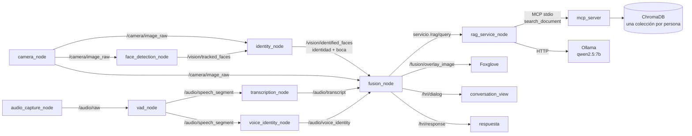

# HRI Candidates Roborregos: ¿quién habla y qué puede saber?

Sistema en ROS 2 Jazzy que, viendo y escuchando a varias personas frente a una laptop,
decide quién está hablando, verifica su identidad fusionando **cara, voz y movimiento de
boca**, y responde su pregunta usando **únicamente el documento privado de esa persona**
(RAG local con Ollama). Si la confianza no alcanza, vuelve a preguntar o se niega.
Rechaza a desconocidos y a intentos de suplantación con foto o audio grabado.

**Video DEMO:** _pendiente_

---

## Contenido

1. [Cómo funciona](#cómo-funciona)
2. [Requisitos](#requisitos)
3. [Instalación desde cero](#instalación-desde-cero)
4. [Enrolar a una persona](#enrolar-a-una-persona)
5. [Arrancar el sistema](#arrancar-el-sistema)
6. [Interfaces propias](#interfaces-propias)
7. [Tópicos, servicios y nodos](#tópicos-servicios-y-nodos)
8. [Parámetros](#parámetros)
9. [Evaluación](#evaluación)
10. [Estructura del repositorio](#estructura-del-repositorio)
11. [Solución de problemas](#solución-de-problemas)

---

## Cómo funciona



1. **Visión.** `face_detection_node` detecta caras con YOLOv8-face y les asigna un
   `track_id` estable con ByteTrack. `identity_node` compara cada cara con las enroladas
   (InsightFace `buffalo_l`, ArcFace, similitud coseno) y mide la apertura de la boca con
   los 68 puntos 3D del mismo modelo.
2. **Audio.** `vad_node` (Silero VAD) corta el audio en frases. Cada frase va a
   `transcription_node` (faster-whisper `small`) y a `voice_identity_node` (ECAPA de
   SpeechBrain).
3. **Fusión.** `fusion_node` junta las tres señales de la ventana de tiempo de la frase y
   calcula una confianza `C = 0.5·cara + 0.3·voz + 0.2·boca`. Cada señal se normaliza
   entre dos anclas medidas con datos reales. Si la boca no se movió (foto o audio
   grabado), no se responde.
4. **Política de tres estados.**

   | Confianza `C` | Decisión | Lo que dice el robot |
   |---|---|---|
   | `C ≥ 0.90` | responder | la respuesta sacada del documento |
   | `0.65 ≤ C < 0.90`, o boca quieta | preguntar | "Por seguridad. Mira a la cámara y repite tu pregunta." |
   | `C < 0.65`, desconocido o segunda falla seguida | negar | "Lo siento, no tienes acceso, así que no puedo consultar ningún documento." |

   El permiso queda atado al `track_id` de la cara que lo ganó. Se revoca si esa cara
   desaparece más de 2 s, si su confianza cae debajo del corte por más de 1 s o si
   empieza a hablar otra persona.
5. **RAG.** Solo con `C` suficiente, `fusion_node` llama al servicio `/rag/query` con la
   persona y su confianza. `rag_service_node` vuelve a revisar la confianza (segunda
   puerta, `access_threshold`) y busca en la colección de **esa** persona a través de un
   servidor MCP. Después pide la respuesta a Ollama. Si el modelo cita una frase que no
   está literalmente en el documento, la respuesta se descarta. Si el dato no está en el
   documento, dice "No encontré esa información en el documento de {persona}."

---

## Requisitos

| | |
|---|---|
| Sistema | Linux con PipeWire o PulseAudio (probado en Fedora) |
| GPU | NVIDIA con driver propietario y **NVIDIA Container Toolkit** (probado en RTX 4060 Laptop, 8 GB) |
| Software | Docker con el plugin `docker compose`, y [Ollama](https://ollama.com) instalado en el host |
| Disco | ~50 GB: imagen de Docker ~41 GB, modelos ~6 GB, modelo de Ollama ~4.7 GB |
| Cámara | Webcam USB, o un celular o tablet con la app **IP Webcam** en la misma red |
| Micrófono | El de la laptop; entra al contenedor por el socket de PipeWire |

---

## Instalación desde cero

### 1. Clonar el repositorio

```bash
git clone https://github.com/Alb3r7g/HRI_CandidatesRoborregos.git
cd HRI_CandidatesRoborregos
mkdir -p data/documents data/enrolled/voice data/bags data/models
```

`data/` no está en el repositorio: ahí viven las caras y voces enroladas, los documentos
privados, los bags y los modelos descargados.

### 2. Descargar el modelo de lenguaje

```bash
ollama pull qwen2.5:7b
```

`docker-compose.yml` monta en el contenedor el binario de Ollama del host
(`/usr/bin/ollama` y `/usr/lib/ollama`) y sus modelos (`~/.ollama`). Así, el launch puede
arrancar `ollama serve` él mismo y no hace falta instalar Ollama dentro de la imagen.
Comprueba dónde quedó instalado con `which ollama`. Si no está en `/usr/bin` (el script
oficial lo deja en `/usr/local/bin`), corrige esas dos rutas en `docker-compose.yml`.

### 3. Construir la imagen y levantar el contenedor

```bash
docker compose build
docker compose up -d
```

La imagen parte de `nvidia/cuda:12.6.3-cudnn-devel-ubuntu24.04` e instala ROS 2 Jazzy,
foxglove_bridge y las librerías de Python (ver [Dockerfile](Dockerfile)). Durante el build
ya se descargan los pesos de YOLOv8-face y de InsightFace `buffalo_l`.

### 4. Compilar el workspace (una sola vez)

```bash
docker exec -it hri_dev bash
cd /ros2_ws
colcon build --symlink-install
source install/setup.bash
```

`ros2_ws/` se monta desde el host, así que lo compilado sobrevive aunque se recree el
contenedor.

### 5. Modelos que se descargan solos la primera vez

La primera ejecución de cada nodo descarga su modelo a `data/models/` (~6 GB en total).
Las siguientes ejecuciones ya no lo descargan.

| Modelo | Lo usa | Para qué |
|---|---|---|
| faster-whisper `small` (int8_float16) | `transcription_node` | voz a texto |
| `speechbrain/spkrec-ecapa-voxceleb` | `voice_identity_node`, `enroll_voice.py` | huella de voz |
| `BAAI/bge-m3` | ingesta y `rag_service_node` | embeddings de los documentos |

---

## Enrolar a una persona

El nombre debe ser **idéntico** en cara, voz y documento: mayúscula inicial, sin
espacios ni acentos (por ejemplo `Sebastian`). Todo se corre dentro del contenedor, con
el sistema **apagado**.

### Cara

El script abre la cámara por índice, así que necesita la webcam USB dentro del
contenedor. Ajusta la ruta del dispositivo en
[docker-compose.webcam.yml](docker-compose.webcam.yml) (`ls /dev/v4l/by-id/`) y recrea el
contenedor con ese archivo:

```bash
docker compose -f docker-compose.yml -f docker-compose.webcam.yml up -d --force-recreate
docker exec -it hri_dev bash
python3 /ros2_ws/src/hri_identity/enroll_person.py --name Sebastian --device 0
```

Toma varias muestras de la cara y guarda el promedio en `data/enrolled/Sebastian.npy`.

### Voz

Hay tres fuentes posibles. Basta ~1 minuto de habla.

```bash
python3 /ros2_ws/src/hri_identity/enroll_voice.py --name Sebastian --record 60
python3 /ros2_ws/src/hri_identity/enroll_voice.py --name Sebastian --files /data/audio/nota.opus
python3 /ros2_ws/src/hri_identity/enroll_voice.py --name Sebastian --bags Sebastian_01
```

Se guarda en `data/enrolled/voice/Sebastian.npy`. Sin voz enrolada, la confianza máxima
posible es 0.70 y el sistema nunca le responderá a esa persona.

### Documento privado

Escribe `data/documents/Sebastian.md` en Markdown:

```markdown
# Documento privado — Sebastián Alemán

## Datos generales de Sebastián

Texto en primera persona...

## Los roomies de Sebastián

**Mi roomie Albert.** Albert, no yo, estudia...
```

Cada sección `##` es un fragmento del índice, y cada bloque que empieza con `**...**`
dentro de una sección se separa en un fragmento propio. Escribe a nombre de la persona y
deja claro de quién es cada dato. Con un modelo de 7B, una frase sobre otra persona
redactada igual que las del dueño puede terminar atribuida al dueño.

Indexa el documento:

```bash
python3 /ros2_ws/src/hri_rag/ingest_documents.py --person Sebastian
```

Sin `--person` indexa todos los documentos. Cada persona tiene su propia colección en
ChromaDB (`data/chroma/`), y el servicio solo busca en la colección de quien pregunta.

---

## Arrancar el sistema

### Con un solo comando (host)

```bash
./hoy_si_este_si.sh 192.168.0.42
```

El argumento es la IP de la tablet con IP Webcam. Sin argumento usa `CAMERA_SOURCE` de
`.env`, o la webcam USB si está vacío. El script:

1. levanta el contenedor,
2. abre una ventana con la vista de conversación,
3. a los 15 s abre Foxglove en el navegador,
4. corre el launch.

### Con un solo `ros2 launch` (dentro del contenedor)

```bash
source /ros2_ws/install/setup.bash
ros2 launch hri_bringup hoy_si_este_si.launch.py camera_source:=http://192.168.0.42:8080/video
```

El launch arranca `ollama serve` si no estaba corriendo, precarga el modelo en la GPU y
levanta los 9 nodos más `foxglove_bridge`. Está listo, ~40 s después, cuando el log
muestra:

```
Ollama listo: qwen2.5:7b cargado en la GPU
[fusion_node]: Cortes: responder >= 0.90, re-preguntar >= 0.65, margen 0.05, ...
[rag_service_node]: MCP listo, herramientas: search_document ...
```

| Argumento | Default | Uso |
|---|---|---|
| `camera_source` | `$CAMERA_SOURCE` | URL `http://IP:8080/video`, o vacío para la webcam USB |
| `use_sensors` | `true` | `false` para no lanzar cámara ni micrófono (al reproducir un bag) |
| `use_sim_time` | `false` | `true` junto con `ros2 bag play --clock` |
| `foxglove` | `true` | lanzar `foxglove_bridge` en el puerto 8765 |
| `ollama` | `true` | arrancar y precargar Ollama |
| `llm_model` | `qwen2.5:7b` | modelo que se precarga |
| `config` | `hri_bringup/config/hri.yaml` | archivo de umbrales |

### Ver lo que pasa

- **Overlay** (identidad, quién habla, confianza): [Foxglove](https://app.foxglove.dev),
  conexión `ws://localhost:8765`, panel Image con `/fusion/overlay_image`.
- **Conversación turno por turno**: `ros2 run hri_fusion conversation_view`. Muestra lo
  que se dijo, la identidad, los valores de cara, voz y boca, `C`, la decisión con su razón
  y la respuesta.

La primera pregunta tras arrancar tarda más porque los modelos terminan de cargar. Haz
una pregunta de calentamiento antes de presentar.

### Reproducir un bag

```bash
ros2 launch hri_bringup hoy_si_este_si.launch.py use_sensors:=false use_sim_time:=true
ros2 bag play /data/bags/<bag> --clock --topics /camera/image_raw /audio/raw
```

Los bags guardan solo `/camera/image_raw` y `/audio/raw`. Así todo el pipeline se puede
reejecutar con otros umbrales sobre los mismos datos. Para grabar uno nuevo:
`ros2_ws/scripts/record_bag.sh <nombre>`.

---

## Interfaces propias

Paquete [hri_interfaces](ros2_ws/src/hri_interfaces).

### Mensajes

**`AudioChunk.msg`**: bloque de audio crudo (512 muestras a 16 kHz, ~31 Hz). El formato
viaja con cada mensaje para que un bag sea autodescriptivo. `stamp` marca cuándo ocurrió
el sonido, no cuándo llegó.

```
std_msgs/Header header
float32[] samples
uint32 sample_rate
uint8 channels
```

**`VoiceActivity.msg`**: probabilidad de voz por bloque. Se publica también la
probabilidad cruda para poder recalibrar el umbral con datos grabados.

```
std_msgs/Header header
float32 speech_probability
bool is_speech
```

**`SpeechSegment.msg`**: una frase completa, publicada al detectar el fin del habla. Lleva
el audio acumulado para que transcripción y voz no repitan el buffering.

```
std_msgs/Header header        # stamp = inicio de la frase
float32[] samples
uint32 sample_rate
uint8 channels
```

**`Transcript.msg`**: texto de una frase.

```
std_msgs/Header header
float32 duration
string text
string language
float32 confidence
```

**`VoiceIdentity.msg`**: a quién se parece la voz de una frase.

```
std_msgs/Header header
float32 duration
string identity_name
float32 similarity            # coseno contra la huella enrolada
bool is_known
```

**`TrackedFace.msg`** / **`TrackedFaceArray.msg`**: caja de una cara y su ID de track.

```
uint32 track_id
float32 bbox_x
float32 bbox_y
float32 bbox_width
float32 bbox_height
float32 detection_confidence
```

**`IdentifiedFace.msg`** / **`IdentifiedFaceArray.msg`**: cara con identidad y apertura de
boca.

```
TrackedFace face
string identity_name          # "desconocido" si no supera el umbral
float32 identity_confidence
bool is_known
float32 mouth_open
```

**`DialogTurn.msg`**: un turno completo de la conversación, con todo lo necesario para
explicar la decisión.

```
std_msgs/Header header
string question
string identity
float32 face
float32 voice
float32 mouth
bool live                     # pasó la compuerta de movimiento de boca
float32 confidence            # C fusionada
string decision               # responder / preguntar / negar
string reason
string answer
float32 answer_seconds
uint32 quotes                 # citas verificadas en el documento
```

### Servicio

**`QueryDocument.srv`**: consulta al documento privado. La identidad y su confianza son
campos obligatorios: el servidor niega la consulta si la confianza no llega a
`access_threshold`.

```
string person
float32 identity_confidence
string question
---
uint8 ANSWERED=0
uint8 NOT_IN_DOCUMENT=1
uint8 DENIED=2
uint8 LLM_UNAVAILABLE=3
uint8 status
string answer
string[] quotes
```

### Acciones

El proyecto no define acciones. La justificación está en el reporte E2.

---

## Tópicos, servicios y nodos

| Nodo | Paquete | Se suscribe a | Publica / ofrece |
|---|---|---|---|
| `camera_node` | hri_camera | (webcam o URL) | `/camera/image_raw` (Image) |
| `audio_capture_node` | hri_audio | (micrófono) | `/audio/raw` (AudioChunk) |
| `face_detection_node` | hri_vision | `/camera/image_raw` | `/vision/tracked_faces` (TrackedFaceArray), `/vision/debug_image` |
| `identity_node` | hri_identity | `/camera/image_raw` + `/vision/tracked_faces`, sincronizados | `/vision/identified_faces` (IdentifiedFaceArray), `/vision/identity_debug_image` |
| `vad_node` | hri_audio | `/audio/raw` | `/audio/voice_activity` (VoiceActivity), `/audio/speech_segment` (SpeechSegment) |
| `transcription_node` | hri_audio | `/audio/speech_segment` | `/audio/transcript` (Transcript) |
| `voice_identity_node` | hri_identity | `/audio/speech_segment` | `/audio/voice_identity` (VoiceIdentity) |
| `fusion_node` | hri_fusion | `/vision/identified_faces`, `/audio/transcript`, `/audio/voice_identity`, `/camera/image_raw` | `/fusion/overlay_image`, `/hri/dialog` (DialogTurn), `/hri/response` (String); cliente de `/rag/query` |
| `rag_service_node` | hri_rag | | servicio `/rag/query` (QueryDocument); cliente MCP de `hri_rag.mcp_server` |
| `conversation_view` | hri_fusion | `/hri/dialog` | (texto en terminal) |

El servidor MCP (`hri_rag/mcp_server.py`) corre como subproceso de `rag_service_node` por
stdio y expone la herramienta `search_document(person, question)`. Nunca recibe una
consulta sin identidad validada, porque el único cliente es el servicio y este verifica
la confianza antes.

---

## Parámetros

Todos en [hri.yaml](ros2_ws/src/hri_bringup/config/hri.yaml). Después de editarlo hay
que recompilar `hri_bringup` y relanzar.

| Nodo | Parámetro | Valor | Qué hace |
|---|---|---|---|
| `identity_node` | `similarity_threshold` | 0.20 | similitud mínima para ponerle nombre a una cara |
| `voice_identity_node` | `similarity_threshold` | 0.35 | lo mismo para la voz |
| `rag_service_node` | `access_threshold` | 0.85 | segunda puerta: confianza mínima para consultar |
| `fusion_node` | `high_threshold` | 0.90 | corte para responder |
| `fusion_node` | `low_threshold` | 0.65 | corte para volver a preguntar |
| `fusion_node` | `margin` | 0.05 | histéresis para no perder el permiso por ruido |
| `fusion_node` | `liveness_min` | 0.015 | movimiento de boca mínimo (anti foto y audio grabado) |
| `fusion_node` | `reask_window_s` | 20.0 | cuánto dura la re-pregunta antes de caducar |
| `fusion_node` | `face_absent_s` | 2.0 | tiempo sin la cara para revocar el permiso |
| `fusion_node` | `revoke_after_s` | 1.0 | tiempo bajo el corte para revocar el permiso |
| `vad_node` | `min_silence_ms` | 750 | silencio que cierra una frase |
| `transcription_node` | `model_size` | small | modelo de whisper |

`voice_identity_node` y `rag_service_node` leen su umbral en cada consulta, así que se
pueden cambiar en caliente con `ros2 param set`. Los demás se leen al arrancar.

---

## Evaluación

Dentro del contenedor:

```bash
python3 /ros2_ws/src/hri_rag/evaluate_retrieval.py Albert     # ¿el fragmento correcto queda en el top-k?
python3 /ros2_ws/src/hri_rag/evaluate_answers.py Albert       # respuestas y trampas (necesita Ollama)
python3 /ros2_ws/src/hri_identity/evaluate_voice.py --person Albert \
    --person-bags Albert_02 --impostor-bags Desconocido_01 Desconocido_02 --use-enrolled
python3 /ros2_ws/src/hri_fusion/evaluate_fusion.py            # intentos genuinos e impostores sobre los bags
python3 /ros2_ws/src/hri_fusion/plot_far_frr.py --high 0.90 --low 0.65
```

Los sets de evaluación (`data/eval/<Persona>.json`) tienen dos partes: preguntas cuya
respuesta está en el documento y "trampas" que deben rechazarse (dato ausente, dato
declarado privado, dato de otra persona). Los archivos de evaluación nunca se indexan,
porque si entraran al índice la medición dejaría de valer.

Resultados actuales del RAG:

| Persona | Recuperación | Respuestas correctas | Trampas rechazadas |
|---|---|---|---|
| Albert | 10/10 | 10/10 | 3/3 |
| Sebastian | 7/7 | 7/7 | 3/3 |

La curva FAR vs FRR, la calibración de umbrales y el punto de operación están en el
reporte E2.

---

## Estructura del repositorio

```
.
├── Dockerfile                    imagen: CUDA 12.6 + ROS 2 Jazzy + modelos de visión, audio y RAG
├── docker-compose.yml            contenedor hri_dev: GPU, red del host, audio por PipeWire, Ollama del host
├── docker-compose.webcam.yml     agrega la webcam USB (para enrolar caras)
├── hoy_si_este_si.sh             arranque con un comando: contenedor + launch + vista + Foxglove
├── docs/
└── ros2_ws/
    ├── scripts/
    │   ├── record_bag.sh             graba un bag de cámara y micrófono con un guion fijo de 8 etapas
    │   ├── analyze_vad.py            calibra los umbrales del VAD con las probabilidades publicadas (en vivo o con un bag)
    │   ├── compare_embeddings.py     comparación de modelos de embeddings con la que se eligió bge-m3
    │   ├── diag_voz.py               graba unos segundos del micrófono y reporta nivel y frases detectadas
    │   ├── enroll_face_from_bag.py   enrola una cara a partir de los cuadros de un bag
    │   └── play_bag_audio.py         reproduce por las bocinas el audio de un bag (para grabar la demo)
    └── src/
        ├── hri_interfaces/           mensajes y servicio propios (ver arriba)
        ├── hri_camera/
        │   └── camera_node.py            publica frames de una webcam (índice) o de una URL (IP Webcam); se reconecta solo
        ├── hri_vision/
        │   ├── face_detection_node.py    YOLOv8-face + ByteTrack: cajas con track_id estable
        │   └── launch/vision_pipeline.launch.py   launch parcial de la semana 1 (solo visión)
        ├── hri_identity/
        │   ├── identity_node.py          identidad facial (ArcFace) y apertura de boca por track
        │   ├── voice_identity_node.py    verificación de voz por frase (ECAPA)
        │   ├── voice.py                  carga de ECAPA y cálculo de huellas de voz
        │   ├── enroll_person.py          enrola una cara desde la webcam
        │   ├── enroll_voice.py           enrola una voz desde micrófono, archivos o bags
        │   └── evaluate_voice.py         separación genuino contra impostores en bags
        ├── hri_audio/
        │   ├── audio_capture_node.py     captura del micrófono en bloques de 512 muestras
        │   ├── vad_node.py               Silero VAD con máquina de estados propia: corta frases
        │   └── transcription_node.py     faster-whisper sobre cada frase
        ├── hri_rag/
        │   ├── chunking.py               troceado de Markdown por secciones y bloques
        │   ├── store.py                  ChromaDB con una colección por persona + embeddings bge-m3
        │   ├── mcp_server.py             servidor MCP con la herramienta search_document
        │   ├── document_search.py        cliente MCP (stdio) que usa el nodo
        │   ├── llm.py                    prompt, llamada a Ollama y verificación literal de citas
        │   ├── rag_service_node.py       servicio /rag/query con la puerta de acceso
        │   ├── ingest_documents.py       indexa data/documents/*.md
        │   ├── evaluate_retrieval.py     mide la recuperación con el set de evaluación
        │   └── evaluate_answers.py       mide respuestas y trampas de punta a punta
        ├── hri_fusion/
        │   ├── fusion.py                 normalización, confianza fusionada y política de tres estados
        │   ├── fusion_node.py            ventana temporal por frase, permiso por track, overlay y diálogo
        │   ├── conversation_view.py      vista de texto de cada turno para la demo
        │   ├── evaluate_fusion.py        reproduce intentos sobre los bags y guarda las señales
        │   └── plot_far_frr.py           curva FAR vs FRR y punto de operación
        └── hri_bringup/
            ├── launch/hoy_si_este_si.launch.py   un solo launch para todo el sistema, incluido Ollama
            └── config/hri.yaml                   umbrales de todos los nodos
```

Fuera del repositorio, en `data/`:

```
data/
├── documents/<Persona>.md     documentos privados (se indexan)
├── eval/<Persona>.json        sets de evaluación (no se indexan)
├── enrolled/<Persona>.npy     huellas faciales
├── enrolled/voice/<Persona>.npy   huellas de voz
├── chroma/                    índice vectorial
├── bags/                      grabaciones de cámara y micrófono
└── models/                    modelos descargados (whisper, ECAPA, bge-m3)
```

---

## Solución de problemas

| Síntoma | Causa probable |
|---|---|
| `"Ahora mismo no puedo consultar los documentos"` | Ollama no corre o no tiene el modelo: `ollama list` debe mostrar `qwen2.5:7b`, y `ollama ps` debe decir `100% GPU` |
| Siempre re-pregunta aunque estés de frente | Revisa en el log de `fusion_node` los valores de cara, voz y boca de la frase. Boca 0.000 significa que no hubo cuadros de cara durante la frase (cámara caída o modelos calentando) |
| La tablet no entrega video | Laptop y tablet en la misma red. Abre `http://IP:8080` en el navegador: si no carga, el problema no es ROS. En redes de eventos, usa el hotspot del celular |
| No entra el micrófono | `python3 -c "import sounddevice as sd; print(sd.query_devices())"` dentro del contenedor debe listar `pulse` |
| Visión en CPU | El log de `identity_node` debe decir `CUDAExecutionProvider`. Una dependencia nueva de pip puede reinstalar `onnxruntime` (CPU) encima de `onnxruntime-gpu`; el Dockerfile lo corrige al final |
| La webcam USB desaparece | Se cae del bus USB: revisa `ls /dev/video*` en el host y recrea el contenedor con `--force-recreate` |
