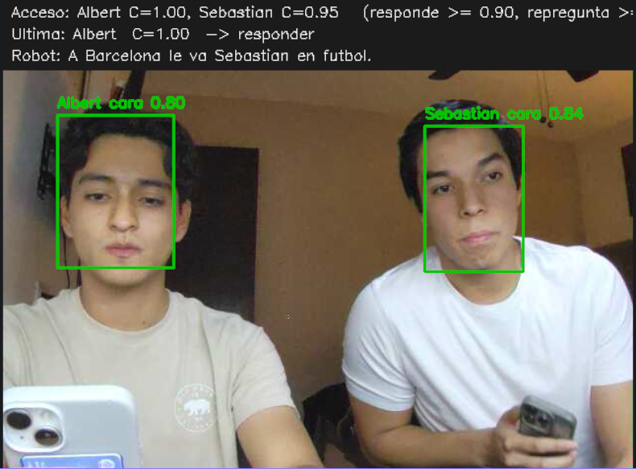
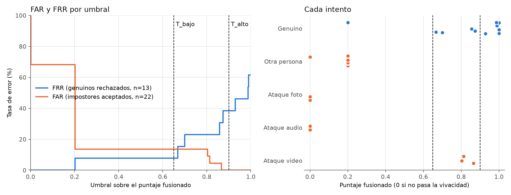
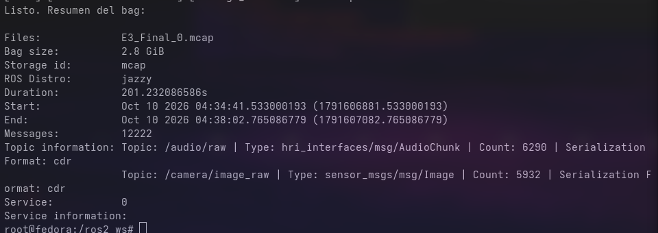
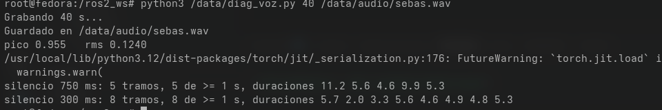

# Bitácora · Reto HRI/Visión

**Candidates RoBorregos 2026** · Albert Gerardo Constantino Salazar · A01664787

Repositorio: https://github.com/Alb3r7g/HRI_CandidatesRoborregos

Registro cronológico de actividades, decisiones y evidencia. Las fechas de código salen del
historial de git; las mediciones, de los scripts de evaluación del repositorio
(`compare_embeddings.py`, `evaluate_retrieval.py`, `evaluate_answers.py`,
`evaluate_voice.py`, `evaluate_fusion.py`), con los que se pueden reproducir.

**Sobre el ritmo de trabajo.** El avance no fue constante semana a semana. La carga de la
escuela variaba: en las semanas más pesadas el proyecto avanzó poco, y en las más ligeras se
concentró mucho trabajo, a veces el de dos semanas del plan en una sola, o varios entregables
en un mismo día. Por eso las fechas de los commits se agrupan en pocos días (19 sep, 2 oct,
3 oct y 9 oct). Las fechas reflejan cuándo se registró cada avance en git, no necesariamente
todos los días en que se trabajó en él.

**Qué está en el repositorio y qué no.** El código, los scripts de evaluación, el README, el
reporte E2 y esta bitácora están en el repositorio. La carpeta `data/` es privada y está
excluida con `.gitignore`. Contiene los documentos personales que consulta el RAG, las huellas
faciales y de voz, los bags grabados (que muestran rostros y voces), los sets de evaluación
(que contienen datos personales) y los modelos descargados. Las cifras que se citan aquí salen
de correr los scripts del repositorio sobre esos datos privados.

---

## Semana 1 · Base ROS 2 y visión (4 – 25 sep)

**4 sep.** Estructura del workspace ROS 2 Jazzy y primeras interfaces propias
(`TrackedFace`, `IdentifiedFace`). Commits `78e8b77`, `e0d36c1`.

**19 sep.** Entorno en Docker con CUDA 12.6 y ROS 2 Jazzy, y foxglove_bridge para ver
tópicos desde el navegador.

- `hri_vision`: detección con YOLOv8-face y tracking con ByteTrack (IDs estables entre
  cuadros).
- `hri_identity`: identidad facial con InsightFace `buffalo_l` (ArcFace, similitud coseno) y
  enrolamiento por promedio de embeddings.
- **Problema resuelto:** `chromadb` e `insightface` instalan `onnxruntime` de CPU encima de
  `onnxruntime-gpu`, e InsightFace cae a CPU en silencio. El Dockerfile termina reinstalando
  `onnxruntime-gpu`.
- **Problema resuelto:** fijar `numpy<2`, porque `cv_bridge` está compilado contra NumPy 1.

Commits `0bb0d01`, `05b3ab3`, `08632ef`.

**25 sep.** Launch con argumento para reproducir bags. Script de grabación de bags con guion
fijo, para que todas las personas se graben en las mismas condiciones. Captura de micrófono
dentro de Docker montando el socket de PipeWire, en lugar de `/dev/snd`. Commits `4c2b7c6`,
`ec2ba8d`, `d3a8d13`.

## Semana 2 · Audio, RAG y MCP (2 – 3 oct)

**2 oct.**

- Mensajes `AudioChunk`, `VoiceActivity` y `SpeechSegment`.
- Paquete `hri_audio`: captura a 16 kHz en bloques de 512 muestras y VAD con Silero, con
  máquina de estados e histéresis.
- Bags nuevos con audio: genuino, dos desconocidos, grupo, y ataques con foto, video y audio.
- **Elección de embeddings midiendo** con `compare_embeddings.py`: bge-m3 y e5-large 10/10,
  MiniLM 8/10. Gana bge-m3 por tener el rango de similitud más ancho y por no usar prefijos.
- `hri_rag`: ingesta por secciones y una colección de ChromaDB por persona.
- **Hallazgo:** ningún umbral de similitud separa las preguntas contestables de las que no lo
  son (margen −0.086). El rechazo tiene que venir del LLM.

Commits `5e56767` a `1ef8d45`.

**3 oct.**

- Servicio `QueryDocument` con la identidad y su confianza como campos obligatorios.
- Cliente de Ollama (`qwen2.5:7b`, local, en GPU) con **verificación de citas literales**.
- Transcripción con faster-whisper `small` int8 (464 MiB contra 752 en float16, con el mismo
  texto).
- Verificación de voz con ECAPA y servidor **MCP** con la herramienta `search_document`.
- RAG de Albert: 10/10 contestables y 3/3 trampas.

Commits `5418d4d` a `aba4ad6`.

## Semana 3 · Fusión y calibración (3 oct)

- **Boca:** apertura de labios con los 68 puntos que InsightFace ya calcula (AUC 0.75).
  MediaPipe se descartó porque instala numpy 2.
- **Cámara:** la webcam USB se cayó del bus. Se migró a una tablet con IP Webcam, y
  `camera_node` acepta una URL y se reconecta solo.
- **`fusion_node`:**
  - asociación voz-cara por la boca más activa;
  - confianza C = 0.5·cara + 0.3·voz + 0.2·boca, con anclas sacadas de los datos;
  - compuerta de vida (boca < 0.015 → 0);
  - política de tres estados con cortes 0.90 / 0.65;
  - permiso atado al `track_id`.
- **Curva FAR/FRR** con 35 intentos (13 genuinos, 22 impostores): a 0.90, FAR 0 % y FRR
  38.5 %. La gráfica está en `docs/img/far_frr.png` del repositorio.
- **Bug encontrado en la prueba de punta a punta:** un video reproducido heredaba el acceso
  de la sesión anterior. Se corrigió atando el permiso al track.
- Un solo launch para todo el sistema (`hri_bringup`).

Commits `4c8584e` a `76b5163`.

## Semana 4 · Integración, pruebas en vivo y robustez (3 – 9 oct)

**Pruebas en vivo.**

- **1.ª prueba:** solo 1 de 7 frases con acceso. La voz cayó de ~0.6 a 0.38–0.52 por el
  ventilador de la laptop (efecto de canal).
- **Corrección:** enrolamiento de voz combinado (silencio + ruido + distancia).
- **2.ª prueba:** 13 de 17 frases con acceso.

**8 oct.**

- Arranque con un solo comando (`hoy_si_este_si.sh`). El launch levanta Ollama y precarga el
  modelo en la GPU.
- Vista de conversación (`DialogTurn`) con la decisión y su razón en cada turno.

**9 oct.**

- **Segunda persona (Sebastian):** su documento privado, set de evaluación propio
  (7/7 y 3/3) y enrolamiento de voz y cara.
- **Hallazgo:** con un LLM de 7B, describir a otra persona en tercera persona dentro de un
  documento hace que le atribuya esos datos al dueño. Redactar nombrando al dueño de cada dato
  lo corrigió (de 6/7 a 7/7).
- **Problema de micrófono:** al 100 % la señal se satura y el VAD no detecta voz. El nivel
  correcto es 26 %, medido con `ros2_ws/scripts/diag_voz.py`.
- **Cara de Sebastian re-enrolada desde un bag de la tablet** (`ros2_ws/scripts/enroll_face_from_bag.py`): 673 muestras, separadas de las
  de Albert usando la huella anterior como semilla. Su similitud pasó de 0.38–0.66 a ~0.84.
- **Bag final del video E3** (201 s) y ensayo reproduciéndolo por el sistema completo:
  - cada persona recibe respuesta de su propio documento;
  - la misma pregunta ("mejor marca de Albert en 100 m") da 11.20 s a Albert y "no encontré"
    a Sebastian;
  - la foto se niega.
- README (instalación, enrolamiento, arranque e interfaces) y reporte de decisiones E2.

## Evidencia

### Capturas

**Overlay en Foxglove (`/fusion/overlay_image`), 9 oct.** Dos personas en cuadro, cada una
identificada con su similitud de cara. Arriba se ve el acceso vigente de cada una, la última
decisión y la respuesta del robot, sacada del documento de Sebastian.



**Curva FAR vs FRR y cada intento** (35 intentos reprocesados de los bags con
`evaluate_fusion.py` y `plot_far_frr.py`). Las líneas punteadas son los cortes 0.65 y 0.90.



**Bag del video E3** (`ros2 bag info`): 201 s, 5932 cuadros a 29.5 Hz y 6290 bloques de
audio a 31.3 Hz.



**Diagnóstico del micrófono con la voz de Sebastian** (`ros2_ws/scripts/diag_voz.py`, al 26 %): señal sana
(pico 0.955) y 5 frases útiles con silencios de 750 ms.



### Fragmentos de código

**Confianza fusionada y compuerta de vida** (extracto de `hri_fusion/fusion.py`; las constantes están en una línea cada una). La misma lógica la usan
el nodo en vivo y la evaluación offline.

```python
ANCHORS = {'face': (0.20, 0.55), 'voice': (0.35, 0.60), 'mouth': (0.006, 0.020)}
WEIGHTS = {'face': 0.5, 'voice': 0.3, 'mouth': 0.2}

def normalize(value, signal):
    low, high = ANCHORS[signal]
    if value is None:
        return 0.0
    return float(np.clip((value - low) / (high - low), 0.0, 1.0))

def fused_confidence(face, voice, mouth):
    parts = {'face': face, 'voice': voice, 'mouth': mouth}
    return sum(WEIGHTS[s] * normalize(v, s) for s, v in parts.items())

@property
def score(self):
    return self.confidence if self.live else 0.0
```

**Política de tres estados con histéresis** (extracto simplificado de `AccessPolicy.decide`: se omiten la rama de boca quieta y las líneas que limpian el estado de re-pregunta).

```python
if identity in self.granted and confidence >= self.high - self.margin:
    return ANSWER
if confidence >= self.high:
    self.granted.add(identity)
    return ANSWER
if confidence >= self.low and identity not in self.asked:
    self.asked.add(identity)
    return ASK
self.revoke(identity)
return DENY
```

**Servicio de consulta con la identidad como campo obligatorio**
(`hri_interfaces/srv/QueryDocument.srv`).

```
string person
float32 identity_confidence
string question
---
uint8 ANSWERED=0
uint8 NOT_IN_DOCUMENT=1
uint8 DENIED=2
uint8 LLM_UNAVAILABLE=3
uint8 status
string answer
string[] quotes
```

### Pruebas y resultados

**Vista de conversación en vivo, 9 oct** (extracto de `conversation_view`). Se ven la
re-pregunta, la respuesta con acceso vigente y el rechazo de un dato que no está en el
documento.

```
 Tú:        ¿Cómo me llamo?
 Quién:     Albert   cara 0.82 · voz 0.46 · boca viva      C = 0.83
 Decisión:  RE-PREGUNTAR  (0.65 ≤ C < 0.90)
 Robot:     Por seguridad. Mira a la cámara y repite tu pregunta.
 Tú:        ¿Cómo me llamo?
 Quién:     Albert   cara 0.82 · voz 0.55 · boca viva      C = 0.94
 Decisión:  RESPONDER  (≥ 0.90)
 Robot:     Te llamas Albert Constantino Salazar.          8.3 s · 1 cita(s)
 Tú:        ¿Quiénes son mis homis?
 Quién:     Albert   cara 0.81 · voz 0.52 · boca viva      C = 0.90
 Decisión:  RESPONDER  (acceso vigente (≥ 0.85))
 Robot:     No encontré esa información en el documento de Albert.
```

**Ensayo del video E3, 9 oct** (bag reproducido por el sistema completo).

| t | Quién | C | Decisión | Respuesta |
|---|---|---|---|---|
| 18.6 s | Albert | 1.00 | responder | Vive con Alejandro del Ángel y Sebastián Alemán |
| 24.1 s | Sebastian | 0.94 | responder | Le va al Barcelona |
| 33.1 s | Albert | 1.00 | responder | Mejor marca: 11.20 s |
| 38.9 s | Sebastian | 1.00 | responder | "No encontré esa información en el documento de Sebastian" |
| 46.0 s | foto | 0.00 | negar | "Lo siento, no tienes acceso…" |

La misma pregunta sobre la marca de Albert da el dato a Albert y "no encontré" a Sebastian:
cada quien solo tiene acceso a su propio documento.

**Evaluación del RAG** (`evaluate_answers.py`):

| Persona | Contestables | Trampas rechazadas | Mediana |
|---|---|---|---|
| Albert | 10/10 | 3/3 | 2.0 s |
| Sebastian | 7/7 | 3/3 | 1.4 s |

## Decisiones principales

| Decisión | Elección | Por qué |
|---|---|---|
| Embeddings | bge-m3 | Medido: rango ancho y sin prefijos |
| LLM | qwen2.5:7b local en Ollama | Multilingüe, salida JSON, cabe en 8 GB con todo lo demás |
| Transcripción | Whisper small int8 | Presupuesto de VRAM |
| Boca | 68 puntos de InsightFace | Costo cero; MediaPipe rompía numpy |
| Fusión | Suma ponderada + compuerta de vida | Explicable y calibrable con pocos datos |
| Cortes | 0.90 / 0.65, margen 0.05 | 0.90 es el umbral más bajo con FAR = 0 |
| Acceso al RAG | 0.85 | Coherente con la histéresis |
| Arquitectura | Tópicos para flujos; servicio para la consulta | La identidad va dentro de la petición |

## Lo que falló y cómo se resolvió

- **Webcam USB caída:** se migró a la tablet por IP Webcam.
- **Voz sensible al ruido:** enrolamiento combinado.
- **La compuerta de vida faltaba:** sin ella, la foto y el audio grabado pasaban.
- **Permiso por nombre:** el video heredaba el acceso. Se ató al track.
- **Verificación de citas exacta:** rechazaba respuestas correctas. Se volvió tolerante.
- **Citas cortas:** bajaron el resultado a 6/10. Se revirtió.
- **Micrófono al 100 %:** se saturaba. Se dejó en 26 %.
